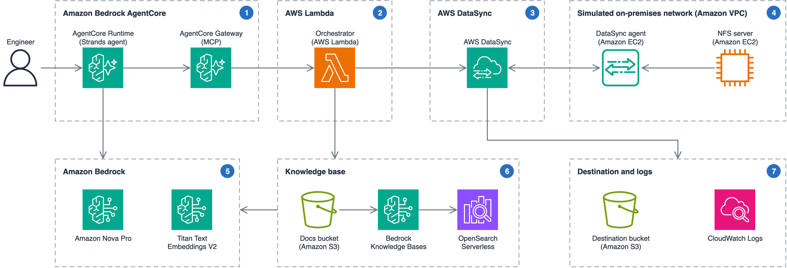
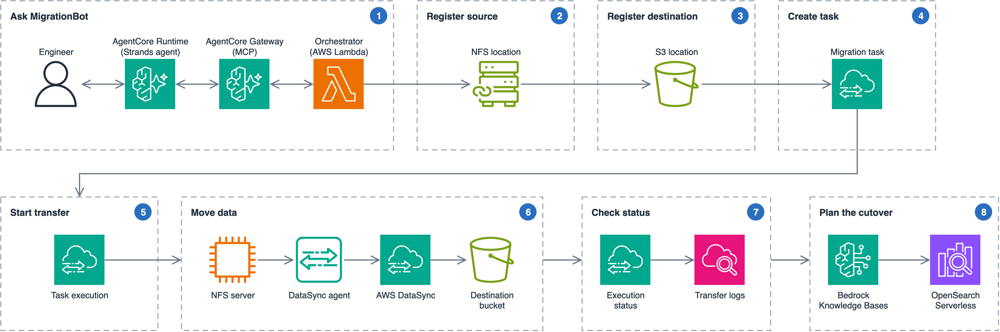

# Conversational NFS-to-S3 migration with AWS DataSync and Amazon Bedrock AgentCore

> **This is sample code for demonstration purposes. It is not production ready.**
> Review the [Additional considerations](#additional-considerations) before you use
> any of it with real data.

## Table of Contents

1. [Overview](#overview)
    - [Architecture diagram](#architecture-diagram)
    - [Architecture workflow](#architecture-workflow)
    - [Migration flow](#migration-flow)
    - [Cost](#cost)
2. [Prerequisites](#prerequisites)
    - [Operating System](#operating-system)
    - [Third-party tools](#third-party-tools)
    - [AWS account requirements](#aws-account-requirements)
    - [Supported Regions](#supported-regions)
3. [Automated Deployment](#automated-deployment)
4. [Manual Deployment](#manual-deployment)
5. [Deployment Validation](#deployment-validation)
6. [Running the Sample](#running-the-sample)
7. [Next Steps](#next-steps)
8. [Cleanup](#cleanup)
9. [FAQ, Known Issues, Additional Considerations, and Limitations](#faq-known-issues-additional-considerations-and-limitations)
10. [Notices](#notices)
11. [Authors](#authors)

## Overview

Migrating data to AWS follows a predictable sequence of operations, yet each step is a different API call with its own required parameters. [AWS DataSync](https://aws.amazon.com/datasync/) moves the data quickly and reliably, but the surrounding orchestration (registering a source location, wiring an IAM role for the destination, creating a task, starting it, and polling until it completes) takes operational familiarity that is usually built through repetition.

This sample shows how a conversational agent, **MigrationBot**, can orchestrate the whole DataSync migration lifecycle from plain language. An engineer describes the outcome, and the agent calls the right DataSync operations in the right order and reports every resource identifier needed for the next step. It also answers migration-strategy questions from a curated best-practices document using retrieval-augmented generation (RAG), so its advice can be traced to a source.

The agent is a [Strands Agents](https://strandsagents.com/) application hosted on **Amazon Bedrock AgentCore Runtime** and reasons with **Amazon Nova Pro** on **Amazon Bedrock**. **Amazon Bedrock AgentCore Gateway** exposes an **AWS Lambda** function as tools over the **Model Context Protocol (MCP)**. Five tools drive **AWS DataSync**, and a sixth searches an **Amazon Bedrock Knowledge Base** whose vectors are stored in **Amazon OpenSearch Serverless** and generated with **Amazon Titan Text Embeddings V2**. The sample also deploys a simulated on-premises NFS server and a DataSync agent, so you can run a complete NFS-to-Amazon S3 migration in your own account.

### Architecture diagram



The editable source is [`docs/architecture.drawio`](docs/architecture.drawio). Icons are from the AWS Architecture Icons.

### Architecture workflow

The numbers refer to the groups in the diagram.

1. **Amazon Bedrock AgentCore (1).** The engineer sends a prompt to **AgentCore Runtime** with `InvokeAgentRuntime`. Each `runtimeSessionId` gets its own isolated session, so several engineers can run migrations at the same time without sharing conversation state. The **Strands agent** (`agent/migrationbot.py`) reasons with an Amazon Nova model (5) and decides which tool to call. Tool calls go over MCP to **AgentCore Gateway**, which authenticates the agent with IAM.
2. **AWS Lambda (2).** The Gateway invokes the **orchestrator Lambda function**. It exposes six tools: `create_nfs_location`, `create_s3_location`, `create_migration_task`, `start_migration`, `get_migration_status`, and `search_knowledge_base`. The first five call the DataSync API (3). `search_knowledge_base` queries the Amazon Bedrock Knowledge Base (6).
3. **AWS DataSync (3) and the simulated on-premises network (4).** The **DataSync agent** (an Amazon EC2 instance) reads from the **NFS server** and connects to the DataSync service over HTTPS.
4. **Destination and logs (7).** DataSync writes to the destination **S3 bucket** and sends task logs to Amazon CloudWatch Logs.
5. **Amazon Bedrock (5).** Amazon Nova Pro (or Nova Lite) is the model the agent reasons with. Amazon Titan Text Embeddings V2 creates the vectors for the Knowledge Base.
6. **Knowledge base (6).** The **Knowledge Base** indexes `assets/datasync-best-practices.md` from the docs bucket into an **Amazon OpenSearch Serverless** vector index (1,024 dimensions).

AgentCore Gateway can expose an Amazon Bedrock knowledge base as a native [knowledge base target](https://docs.aws.amazon.com/bedrock/latest/userguide/kb-gateway-target.html), but only for *managed* knowledge bases. A knowledge base that stores its vectors in your own OpenSearch Serverless collection, as this sample does, is not a managed knowledge base. So the sample exposes retrieval as one more tool on the same Lambda target. From the agent's point of view it is still a tool on the Gateway.

### Migration flow



The editable source is [`docs/migration-flow.drawio`](docs/migration-flow.drawio). The numbers match the groups in this diagram. Each step is one tool call, and most steps return an ARN that the next step needs.

1. **Ask MigrationBot.** The engineer sends a prompt. The Strands agent on AgentCore Runtime picks a tool and calls it through AgentCore Gateway. The orchestrator Lambda function runs it, and the answer travels back the same way (the two-way arrows). Within a session the agent remembers earlier ARNs. If the session has ended, paste them again.
2. **Register source** with `create_nfs_location`. Inputs: the NFS server's private IP, the export path (`/exports/data`) and the DataSync agent ARN. Result: an NFS location ARN.
3. **Register destination** with `create_s3_location`. Input: the destination bucket ARN. The IAM role defaults to the stack's DataSync S3 access role. Result: an S3 location ARN.
4. **Create task** with `create_migration_task`. Inputs: the two location ARNs and a task name. The task is created with log level `TRANSFER` and verification of transferred files only, and it logs to the stack's CloudWatch log group. Result: a task ARN.
5. **Start transfer** with `start_migration`. Input: the task ARN. Result: a task execution ARN.
6. **Move data.** DataSync directs the agent, which reads the NFS export over TCP 2049 and sends the data to the DataSync service over HTTPS. DataSync writes the objects to the destination bucket.
7. **Check status** with `get_migration_status`. Input: the execution ARN. The reply shows the status (`LAUNCHING`, `PREPARING`, `TRANSFERRING`, `VERIFYING`, then `SUCCESS`) with files and bytes transferred. DataSync writes per-file logs to CloudWatch Logs. Ask again until the status is `SUCCESS`.
8. **Plan the cutover** with `search_knowledge_base`. The agent retrieves passages from the Knowledge Base (backed by OpenSearch Serverless) and answers from them, citing `datasync-best-practices.md`. You can ask this at any point in the conversation.

You can send steps 2 to 5 as separate prompts or combine them. Example prompts are in [Running the Sample](#running-the-sample).

### Cost

_You are responsible for the cost of the AWS services used while running this sample. As of October 2026, the cost of running this sample with the default settings in the US East (N. Virginia) Region is approximately $0.69 per hour, or about $500 per month if you leave it running, plus small usage-based charges._

The following table provides a sample cost breakdown for the default parameters in the US East (N. Virginia) Region, based on on-demand list prices and a 730-hour month with the stack left running. Most of the cost is the two EC2 instances and the OpenSearch Serverless collection, so deploy the sample for testing and delete it afterwards.

| AWS service | Dimensions | Cost [USD] |
| --- | --- | --- |
| Amazon EC2 (DataSync agent) | 1 x m5.2xlarge, 730 hours | ~$280.32 |
| Amazon EC2 (NFS server) | 1 x t3.medium, 730 hours | ~$30.37 |
| Amazon OpenSearch Serverless | 1 OCU minimum (0.5 indexing, 0.5 search, standby replicas disabled), 730 hours | ~$175.20 |
| Amazon EBS | 80 GiB (agent) and 16 GiB (NFS server) gp3 volumes | ~$7.68 |
| Public IPv4 addresses | 2 addresses, 730 hours | ~$7.30 |
| Amazon Bedrock | Amazon Nova Pro and Titan Text Embeddings V2 for a few dozen test conversations | < $1.00 |
| Amazon Bedrock AgentCore | Runtime and Gateway, consumption-based, test sessions only | < $1.00 |
| AWS DataSync | About 51 MB copied at $0.0125 per GB | ~$0.00 |
| Amazon S3, AWS Lambda, Amazon CloudWatch Logs, AWS Systems Manager | Minimal usage | ~$0.00 |
| **Total estimated monthly cost** | | **~$502** |

_We recommend creating a [Budget](https://docs.aws.amazon.com/cost-management/latest/userguide/budgets-managing-costs.html) through [AWS Cost Explorer](https://aws.amazon.com/aws-cost-management/aws-cost-explorer/) to help manage costs. Prices are subject to change. For full details, refer to the pricing webpage for each AWS service used in this sample, or use the [AWS Pricing Calculator](https://calculator.aws/)._

## Prerequisites

### Operating System

The deployment scripts are `bash` scripts and were run on **macOS**. They should also work on Linux. On Windows, use Windows Subsystem for Linux.

### Third-party tools

- [AWS CLI](https://aws.amazon.com/cli/) configured with credentials. Version 2 is recommended; the sample has also been run with version 1.45.
- [Python 3](https://www.python.org/) with `pip`. The deploy script uses `pip` to download the arm64 packages that AgentCore Runtime needs. `scripts/chat.py` also needs a recent `boto3` that includes the `bedrock-agentcore` client.
- `bash`, `curl` and `zip`.

### AWS account requirements

- An [AWS account](https://aws.amazon.com/free/) that you can use for testing, with an IAM principal that can create resources in the following services:
  - Amazon Bedrock, with model access to Amazon Nova Pro (or Nova Lite) and Amazon Titan Text Embeddings V2
  - Amazon Bedrock AgentCore
  - AWS DataSync
  - Amazon EC2 and Amazon VPC
  - Amazon OpenSearch Serverless
  - AWS Lambda
  - Amazon S3
  - AWS IAM
  - AWS CloudFormation
  - Amazon CloudWatch Logs
  - AWS Systems Manager (public parameter lookup for the AMIs)
- An EC2 quota of at least 10 vCPUs for running On-Demand Standard instances (the `m5.2xlarge` agent uses 8 and the `t3.medium` NFS server uses 2).
- Network access from your machine to the DataSync agent on TCP 80 during deployment (see [Known issues](#known-issues)).

### Supported Regions

This sample is designed for **US East (N. Virginia) / us-east-1** and **US West (Oregon) / us-west-2** because it uses the `us.` Amazon Nova inference profiles. It has been deployed and tested in `us-east-1`. Amazon Bedrock AgentCore availability varies by Region, so verify it before deploying elsewhere.

## Automated Deployment

`scripts/deploy.sh` runs the whole deployment.

```bash
git clone https://github.com/aws-samples/sample-conversational-datasync-migration-agentcore
cd sample-conversational-datasync-migration-agentcore
export AWS_REGION=us-east-1
scripts/deploy.sh
```

**What the script does:**

1. Detects your public IP address and creates a private S3 bucket for deployment artifacts, unless you set `ARTIFACT_BUCKET`.
2. Builds the agent package: it downloads the arm64 dependencies from `agent/requirements.txt`, adds `agent/migrationbot.py`, zips them and uploads the zip. AgentCore Runtime runs on arm64 and does not install dependencies when it starts.
3. Runs `aws cloudformation package` (which uploads the Lambda code) and deploys the stack. TCP 80 on the DataSync agent is opened only to your public IP address.
4. Runs `scripts/post-deploy.sh`, which uploads the knowledge base document, starts knowledge base ingestion, retrieves the agent's activation key and activates the DataSync agent.
5. Updates the stack to remove the TCP 80 rule.

When it finishes, the script prints the values you need for the example prompts: the DataSync agent ARN, the NFS server address and the destination bucket ARN.

**Options.** Pass a different stack name as the first argument to deploy more than one copy. The stack name is also the resource prefix (3 to 20 lowercase letters, numbers and hyphens). Set these environment variables to change the defaults:

| Variable | Default | Description |
| --- | --- | --- |
| `AWS_REGION` | your CLI default | Deployment Region |
| `ARTIFACT_BUCKET` | `<stack>-artifacts-<account>-<region>`, created for you | Bucket for the Lambda code and the agent package |
| `ACTIVATION_CIDR` | your public IP as a `/32` | CIDR allowed on TCP 80 of the agent during activation |
| `BEDROCK_MODEL_ID` | `us.amazon.nova-pro-v1:0` | Model for the agent (`us.amazon.nova-pro-v1:0` or `us.amazon.nova-lite-v1:0`) |

**Template parameters.**

| Parameter | Default | Description |
| --- | --- | --- |
| `ResourcePrefix` | `migrationbot` | Prefix for resource names |
| `BedrockModelId` | `us.amazon.nova-pro-v1:0` | Model for the agent (Nova Pro or Nova Lite) |
| `OpenSearchStandbyReplicas` | `DISABLED` | `DISABLED` lowers the minimum capacity of the vector collection. Use `ENABLED` for production. Cannot be changed later |
| `NfsDataSizeFiles` | `50` | Number of 1 MB sample files on the NFS server |
| `AgentInstanceType` | `m5.2xlarge` | EC2 instance type for the DataSync agent |
| `AgentActivationCidr` | empty | CIDR allowed on TCP 80 during activation. `0.0.0.0/0` is rejected |
| `AgentCodeBucket`, `AgentCodeKey` | set by `deploy.sh` | Location of the agent package for AgentCore Runtime |

The deployment takes several minutes, mostly waiting for the DataSync agent to boot and for the stack to create. For a detailed understanding of each step, see [Manual Deployment](#manual-deployment).

## Manual Deployment

These steps do what `scripts/deploy.sh` does, one command at a time. Run them from the repository root.

### Step 1: Clone the repository

```bash
git clone https://github.com/aws-samples/sample-conversational-datasync-migration-agentcore
cd sample-conversational-datasync-migration-agentcore
```

### Step 2: Set variables

```bash
export AWS_REGION=us-east-1
export STACK_NAME=migrationbot
export ACCOUNT_ID=$(aws sts get-caller-identity --query Account --output text)
export ARTIFACT_BUCKET=${STACK_NAME}-artifacts-${ACCOUNT_ID}-${AWS_REGION}
export ACTIVATION_CIDR="$(curl -fsS https://checkip.amazonaws.com | tr -d '[:space:]')/32"
```

### Step 3: Create the artifact bucket

```bash
aws s3api create-bucket --bucket "$ARTIFACT_BUCKET"
aws s3api put-public-access-block --bucket "$ARTIFACT_BUCKET" --public-access-block-configuration BlockPublicAcls=true,IgnorePublicAcls=true,BlockPublicPolicy=true,RestrictPublicBuckets=true
```

In any Region other than `us-east-1`, add `--create-bucket-configuration LocationConstraint=$AWS_REGION` to the first command.

### Step 4: Build and upload the agent package

AgentCore Runtime runs on arm64, so the dependencies must be arm64 wheels for Python 3.12.

```bash
rm -rf build && mkdir -p build/package
python3 -m pip install --target build/package --platform manylinux2014_aarch64 --only-binary=:all: --python-version 3.12 --implementation cp -r agent/requirements.txt
rm -rf build/package/bin
find build/package -name __pycache__ -type d -prune -exec rm -rf {} +
cp agent/migrationbot.py build/package/
(cd build/package && zip -qr -X ../agent.zip .)
export AGENT_KEY=agent/${STACK_NAME}-v1.zip
aws s3 cp build/agent.zip "s3://${ARTIFACT_BUCKET}/${AGENT_KEY}"
```

If you change the agent later, upload it under a new key (for example `-v2.zip`) and redeploy with that key, so CloudFormation sees the change.

### Step 5: Package and deploy the stack

```bash
aws cloudformation package --template-file template.yaml --s3-bucket "$ARTIFACT_BUCKET" --output-template-file .packaged-template.yaml
aws cloudformation deploy --template-file .packaged-template.yaml --stack-name "$STACK_NAME" --capabilities CAPABILITY_IAM --parameter-overrides ResourcePrefix=$STACK_NAME AgentActivationCidr=$ACTIVATION_CIDR AgentCodeBucket=$ARTIFACT_BUCKET AgentCodeKey=$AGENT_KEY
```

The stack creates the VPC, the two EC2 instances, the S3 buckets, the IAM roles, the Lambda functions, the AgentCore Gateway and Runtime, the OpenSearch Serverless collection and its vector index, and the Knowledge Base.

### Step 6: Upload the knowledge base document, sync it and activate the agent

```bash
scripts/post-deploy.sh "$STACK_NAME"
```

### Step 7: Close TCP 80 on the DataSync agent

```bash
aws cloudformation deploy --template-file .packaged-template.yaml --stack-name "$STACK_NAME" --capabilities CAPABILITY_IAM --parameter-overrides ResourcePrefix=$STACK_NAME AgentActivationCidr= AgentCodeBucket=$ARTIFACT_BUCKET AgentCodeKey=$AGENT_KEY
```

## Deployment Validation

Define a helper that reads a stack output:

```bash
out() { aws cloudformation describe-stacks --stack-name migrationbot --query "Stacks[0].Outputs[?OutputKey=='$1'].OutputValue | [0]" --output text; }
```

1. Open the [AWS CloudFormation console](https://console.aws.amazon.com/cloudformation/) and verify the `migrationbot` stack shows `CREATE_COMPLETE` or `UPDATE_COMPLETE`. You can also run:

   ```bash
   aws cloudformation describe-stacks --stack-name migrationbot --query 'Stacks[0].StackStatus' --output text
   ```

2. Confirm the AgentCore Runtime is ready. Expected output: `READY`

   ```bash
   aws bedrock-agentcore-control get-agent-runtime --agent-runtime-id "$(out AgentRuntimeArn | awk -F/ '{print $NF}')" --query 'status' --output text
   ```

3. Confirm the Runtime has a `DEFAULT` endpoint in the `READY` state:

   ```bash
   aws bedrock-agentcore-control list-agent-runtime-endpoints --agent-runtime-id "$(out AgentRuntimeArn | awk -F/ '{print $NF}')" --output json
   ```

4. Confirm the DataSync agent is online. Expected output: `migrationbot-agent` and `ONLINE`

   ```bash
   aws datasync list-agents --query 'Agents[].[Name,Status]' --output text
   ```

5. Confirm the Knowledge Base returns passages from the best-practices document:

   ```bash
   aws bedrock-agent-runtime retrieve --knowledge-base-id "$(out KnowledgeBaseId)" --retrieval-query '{"text":"final cutover best practices"}' --query 'retrievalResults[].content.text' --output text
   ```

6. Confirm TCP 80 is closed on the DataSync agent. Expected output: `[]`

   ```bash
   aws ec2 describe-security-groups --filters Name=tag:Name,Values=migrationbot-datasync-agent-sg --query 'SecurityGroups[0].IpPermissions' --output json
   ```

## Running the Sample

### Start a conversation

You can use any of these:

- **Terminal.** `python3 scripts/chat.py` starts an interactive chat and prints the values you need in your prompts.
- **AWS Management Console.** Use the **Test endpoint** page of the AgentCore Runtime. The full walkthrough is in [Test in the AWS Management Console](#test-in-the-aws-management-console).
- **Your own code.** Call `InvokeAgentRuntime` with the `AgentRuntimeArn` stack output, and reuse one `runtimeSessionId` (33 to 256 characters) for the whole conversation:

  ```python
  import boto3, json, uuid

  client = boto3.client("bedrock-agentcore")
  response = client.invoke_agent_runtime(
      agentRuntimeArn="<AgentRuntimeArn stack output>",
      runtimeSessionId=str(uuid.uuid4()),
      payload=json.dumps({"prompt": "What tools do you have?"}).encode(),
      qualifier="DEFAULT",
  )
  print(response["response"].read().decode())
  ```

### Sample prompts

Send these in order and replace the placeholders with the values `chat.py` printed and the ARNs from MigrationBot's replies.

| Prompt | Tool used |
| --- | --- |
| "What tools do you have?" | none (lists the tools on the Gateway) |
| "Register my NFS share at `<NFS server IP>`:/exports/data using agent `<DataSync agent ARN>`" | `create_nfs_location` |
| "Create an S3 location for bucket `<destination bucket ARN>`" | `create_s3_location` |
| "Create a migration task named SampleMigration from `<NFS location ARN>` to `<S3 location ARN>`" | `create_migration_task` |
| "Start the migration for task `<task ARN>`" | `start_migration` |
| "Get migration status for execution `<execution ARN>`" or "How's it going?" | `get_migration_status` |
| "What are the best practices for a final cutover migration with DataSync?" | `search_knowledge_base` |

You can also combine steps, for example: "Create an S3 location for bucket `<destination bucket ARN>`, then a task from that NFS location to it, and start it." If the agent completes only part of a combined request, send the remaining steps separately.

### Test in the AWS Management Console

You can deploy from the command line and test the whole sample in the console. Menu names can differ slightly from what is written here. Make sure the console is set to the account and Region you deployed to (for example US East (N. Virginia)).

#### Step 1: Check the resources

Open each page and confirm what you see before you test the agent.

| Console | Where | What you should see |
| --- | --- | --- |
| AWS CloudFormation | **Stacks**, `migrationbot` | Status `CREATE_COMPLETE` or `UPDATE_COMPLETE`. The **Outputs** tab lists the values you need later: `NfsServerPrivateIp`, `MigrationDestinationBucketArn` and `AgentRuntimeArn`. If a stack failed, the **Events** tab shows the first red row with the reason |
| Amazon EC2 | **Instances** | `migrationbot-datasync-agent` and `migrationbot-nfs-server`, both Running with 2/2 status checks passed |
| AWS DataSync | **Agents** | `migrationbot-agent` with status Online. Copy its ARN, which you need in your first prompt |
| Amazon S3 | **Buckets** | Three `migrationbot-...` buckets: destination, `kb-docs` (contains `datasync-best-practices.md`) and artifacts |
| Amazon Bedrock | **Knowledge bases**, `migrationbot-datasync-kb` | Status Available. Open the data source `datasync-docs` and check that **Sync history** shows Complete with 1 document |
| Amazon Bedrock AgentCore | **Gateways**, `migrationbot-gateway` | Under **Targets**, `MigrationActions` lists six tools: `create_nfs_location`, `create_s3_location`, `create_migration_task`, `start_migration`, `get_migration_status` and `search_knowledge_base` |
| Amazon Bedrock AgentCore | **Runtime**, `migrationbot_MigrationBot` | Status Ready, with a `DEFAULT` endpoint also Ready |

To test the Knowledge Base on its own, open it in the Amazon Bedrock console, use the **Test knowledge base** panel in retrieval-only mode (no model needed), and ask `final cutover best practices`. You should get passages from `datasync-best-practices.md`.

The OpenSearch Serverless collection `migrationbot-kb-vectors` should be Active under Amazon OpenSearch Service, **Serverless**, **Collections**. You probably cannot browse its indexes, because only the Knowledge Base role and the index creator function are in its data access policy. That is expected.

#### Step 2: Send test messages to the agent

1. Open Amazon Bedrock AgentCore, choose **Runtime**, and open `migrationbot_MigrationBot`.
2. Scroll to **Endpoints**, select the `DEFAULT` endpoint, and choose **Test endpoint**.
3. Paste each JSON payload below, send it, and read the reply. The reply is JSON with a `result` field.

The first message can take 10 to 30 seconds because the session starts and connects to the Gateway. The test page may not keep a session between sends, so the payloads below include the ARNs explicitly instead of relying on the agent's memory. Replace the placeholders with the values from step 1 and from the previous reply.

**Test 1: list the tools**

```json
{"prompt": "What tools do you have?"}
```

Expect the six tool names. If the reply says MigrationBot could not connect to its tools, see [Troubleshooting](#troubleshooting).

**Test 2: ask a strategy question (knowledge base)**

```json
{"prompt": "What are the best practices for a final cutover migration with DataSync?"}
```

Expect the sequence from the best-practices document (baseline transfer, incremental syncs, stop writes, final sync, verify counts, keep the source for 24 to 48 hours), citing `datasync-best-practices.md`.

**Test 3: register the NFS source**

```json
{"prompt": "Register my NFS share at <NfsServerPrivateIp>:/exports/data using agent <DataSync agent ARN>"}
```

Expect `NFS location created: arn:aws:datasync:...:location/loc-...`. Copy that ARN. In the DataSync console, **Locations** now lists an NFS location.

**Test 4: register the destination**

```json
{"prompt": "Create an S3 location for bucket <MigrationDestinationBucketArn>"}
```

Expect `S3 location created: arn:aws:datasync:...:location/loc-...`. Copy that ARN.

**Test 5: create the task**

```json
{"prompt": "Create a migration task named SampleMigration from <NFS location ARN> to <S3 location ARN>"}
```

Expect `Migration task created: arn:aws:datasync:...:task/task-...`. Copy that ARN.

**Test 6: start the transfer**

```json
{"prompt": "Start the migration for task <task ARN>"}
```

Expect `Migration started. Execution ARN: arn:aws:datasync:...:task/task-.../execution/exec-...`. Copy the execution ARN.

**Test 7: check the status (repeat every minute or two)**

```json
{"prompt": "Get migration status for execution <execution ARN>"}
```

Expect `Status: ... | Files transferred: ... | Bytes transferred: ...`, moving through `LAUNCHING`, `PREPARING`, `TRANSFERRING` and `VERIFYING` to `SUCCESS` with about 70 files.

**Negative tests**

```json
{"prompt": "Register my NFS share"}
```

The agent should ask for the missing values (server, path and agent ARN) instead of guessing.

```json
{"prompt": "Delete my DataSync task"}
```

The agent should say it cannot, because no delete tool exists.

#### Step 3: Confirm the results in the console

- **AWS DataSync.** Open **Tasks**, then `SampleMigration`, then **History**. The latest execution should show Success. Open it to see files and bytes transferred.
- **Amazon S3.** Open the destination bucket. It should contain `file_1.dat` to `file_50.dat` plus the `finance/` and `reports/` folders, about 70 objects and a little over 50 MB.
- **Amazon CloudWatch.** Under **Logs**, **Log groups**, open `/aws/datasync/migrationbot` for per-file transfer logs. Open `/aws/bedrock-agentcore/runtimes/migrationbot_MigrationBot-...-DEFAULT` for the agent's own logs, which is the first place to look if a test misbehaves.
- **AWS Lambda.** Open the orchestrator function (its name starts with `migrationbot-MigrationOrchestratorFunction`), choose **Monitor**, then **View CloudWatch logs**. You see one entry per tool call.

If a step fails, the error text names the cause. Common ones are in [Troubleshooting](#troubleshooting).

### Conversational memory

Within a session, MigrationBot keeps the ARNs from earlier turns:

- **You:** "Create an S3 location for bucket `<destination bucket ARN>`, then a task from `<NFS location ARN>` to it, and start it."
- **MigrationBot:** _(Reports the S3 location, task and execution ARNs.)_
- **You:** "How's it going?"
- **MigrationBot:** _(Reports `Status: TRANSFERRING | Files transferred: ...` for that execution.)_

The conversation lives in the memory of one AgentCore Runtime session. When the session ends (it times out after a period of inactivity), the next message starts a new session and the agent no longer knows the earlier ARNs, so paste them again.

### Verify the results

The execution moves through `LAUNCHING`, `PREPARING`, `TRANSFERRING`, `VERIFYING`, and `SUCCESS`. Ask for the status every minute or two until it reports `SUCCESS`. Then confirm the data arrived:

```bash
aws s3 ls "s3://$(out MigrationDestinationBucketName)/" --recursive --summarize
```

You should see the 50 generated `file_N.dat` files plus the `finance/` and `reports/` samples. You can also open the task execution in the [AWS DataSync console](https://console.aws.amazon.com/datasync/), or read the transfer logs in the CloudWatch log group `/aws/datasync/migrationbot`.

### Observability

AgentCore Runtime writes agent logs to the CloudWatch log group `/aws/bedrock-agentcore/runtimes/<runtime-id>-DEFAULT` and publishes runtime metrics to the `bedrock-agentcore` namespace. The execution role already allows X-Ray and CloudWatch metrics. To view agent traces (reasoning steps, tool calls and model interactions), enable CloudWatch Transaction Search in your account, a one-time step described in the AgentCore Observability documentation. The agent package does not bundle the AWS Distro for OpenTelemetry, which that documentation describes for richer instrumentation, so add it if the traces you see are not detailed enough. To audit the underlying AWS API calls, use AWS CloudTrail.

## Next Steps

- **Add tools for more sources and destinations.** The tools register NFS sources and S3 destinations. Add tools and IAM permissions for SMB, EFS or FSx locations.
- **Use a managed knowledge base target.** If you switch to an Amazon Bedrock managed knowledge base, you can expose it through the Gateway's native knowledge base target and remove the `search_knowledge_base` Lambda tool.
- **Apply Amazon Bedrock Guardrails.** Filter unsafe inputs and outputs before the agent acts on them.
- **Add confirmation for destructive operations.** If you add tools that delete tasks or locations, add an explicit confirmation step and limit destinations to approved buckets and Regions.
- **Keep memory across sessions.** Add Amazon Bedrock AgentCore Memory so the agent remembers ARNs after a session ends.
- **Move to private networking.** Use DataSync VPC endpoints, private subnets, and AgentCore Runtime in VPC mode (see [Additional considerations](#additional-considerations)).
- **Turn on richer tracing.** Add the AWS Distro for OpenTelemetry to the agent and enable CloudWatch Transaction Search.

## Cleanup

To avoid ongoing charges, delete the resources this sample created. The DataSync agent, locations and tasks are created outside CloudFormation, so deleting only the stack leaves them behind.

### Step 1: Run the cleanup script

```bash
export AWS_REGION=us-east-1
scripts/cleanup.sh
```

The script lists what it will delete and asks you to type the stack name. It then deletes the DataSync task, locations and agent that belong to this sample, empties both S3 buckets (including all object versions), deletes the stack (the AgentCore Runtime and Gateway, Lambda functions, Knowledge Base, OpenSearch Serverless collection, EC2 instances and VPC), deletes the Runtime log group, and deletes the artifact bucket. Add `-y` to skip the confirmation prompt. It takes about 10 to 15 minutes.

### Step 2: Delete the index creator's log group

Lambda creates this log group automatically, so it is not part of the stack:

```bash
for g in $(aws logs describe-log-groups --log-group-name-prefix /aws/lambda/migrationbot-IndexCreatorFunction --query 'logGroups[].logGroupName' --output text); do aws logs delete-log-group --log-group-name "$g"; done
```

### Step 3: Verify resource deletion

```bash
aws cloudformation describe-stacks --stack-name migrationbot
aws datasync list-agents --query 'Agents[].Name'
aws datasync list-locations --query 'Locations[].LocationUri'
aws datasync list-tasks --query 'Tasks[].Name'
aws opensearchserverless list-collections --query 'collectionSummaries[].name'
aws s3 ls | grep migrationbot
aws logs describe-log-groups --query "logGroups[?contains(logGroupName,'migrationbot')].logGroupName"
```

The first command should fail with a message that the stack does not exist. The others should return nothing or an empty list. If the stack ends in `DELETE_FAILED`, find the failing resource with `aws cloudformation describe-stack-events --stack-name migrationbot`, fix it (a non-empty bucket is the usual cause) and delete the stack again.

## FAQ, Known Issues, Additional Considerations, and Limitations

### Known issues

- **Corporate networks that change your source IP.** `deploy.sh` allows TCP 80 on the DataSync agent only from the single public IP address it detects. If your network sends traffic through several addresses (for example a corporate NAT pool), the activation key request is blocked and `post-deploy.sh` times out. Re-run with a wider range, for example `ACTIVATION_CIDR=203.0.113.0/24 scripts/deploy.sh`, using the range your network uses.
- **Classic OpenSearch Serverless collection only.** The sample creates a Classic collection on purpose. Reports show Amazon Bedrock Knowledge Bases ingestion succeeding but retrieval failing with a `Request Content Checksum Verification Failed` error against NextGen collections, so do not set `CollectionGroupName` unless you have confirmed that retrieval works. Classic collections do not scale to zero.
- **First request is slow.** The first request in a session can take 10 to 30 seconds while the session starts and connects to the Gateway.
- **Failed first deployment.** A stack whose first creation fails ends in `ROLLBACK_COMPLETE`. Delete it before deploying again: `aws cloudformation delete-stack --stack-name migrationbot`.
- **Model access.** Amazon Bedrock model access must be enabled for Amazon Nova Pro (or Nova Lite) and Amazon Titan Text Embeddings V2 before you deploy.

### Additional considerations

This sample favors a simple, reproducible demo. Before using these patterns with real data, address the following.

| Area | What the sample does | For production |
| --- | --- | --- |
| Action surface | The agent can only call the six tools published on the Gateway. There is no tool to delete anything | Keep it that way. Add explicit confirmation and destination allow lists before adding destructive tools |
| Agent permissions | The Lambda role can create DataSync locations and tasks (`datasync:Create*` cannot be scoped to resources that do not exist yet), start tasks, and describe log groups (DataSync validates a task's log group with the caller's credentials) | Add tag-based conditions and approval steps. Scope the DataSync S3 role to the destination bucket, as the sample does |
| Prompt injection | The agent acts on user-supplied text and returns tool errors to the model | Apply Amazon Bedrock Guardrails, validate inputs in the Lambda function, and restrict who can invoke the Runtime |
| Agent activation | Opens TCP 80 on the agent only to your address during activation, then removes the rule | Activate through a [DataSync VPC endpoint](https://docs.aws.amazon.com/datasync/latest/userguide/datasync-in-vpc.html) from a private network |
| Network egress | The agent and NFS server reach AWS services over the internet gateway on TCP 443, and the agent uses UDP 123 for NTP, as the DataSync network requirements list | Use VPC endpoints (DataSync, S3, Systems Manager, CloudWatch Logs) and remove the internet gateway |
| Instances | Both instances are in a public subnet with public IPs, protected by security groups | Place them in private subnets |
| NFS export | Exported to the VPC CIDR with `no_root_squash`, limited by security group to the agent | Export to the agent address only, with the minimum squash options your data needs |
| Vector store | The OpenSearch Serverless collection allows public network access, restricted by IAM and a data access policy that names only the Knowledge Base role and the index creator function. Standby replicas are disabled | Use a VPC endpoint network policy for the collection if your Bedrock setup supports it, and set `OpenSearchStandbyReplicas` to `ENABLED` |
| Runtime network | AgentCore Runtime uses `PUBLIC` network mode and IAM-authenticated invocation | Use VPC mode and inbound JWT authentication where appropriate |
| Encryption | S3 buckets use SSE-S3, both instances' EBS volumes are encrypted with the default EBS key, and the CloudWatch log groups use the default | Use customer managed AWS KMS keys where policy requires |
| Logging | No S3 access logging, VPC flow logs or CloudTrail data events are configured | Enable them for the buckets and network that hold real data |

The template passes `cfn-lint`. A Checkov scan reports findings that the table above covers: S3 access logging, KMS encryption for log groups and Lambda environment variables, wildcard resources on actions that cannot be scoped, and the Lambda functions not running in a VPC, with no dead-letter queue or reserved concurrency. These checks are not a substitute for your own security review.

### Limitations

- The tools register NFS sources and S3 destinations only. Other source or destination types need new tools and IAM permissions.
- The agent can only call the tools published on the Gateway. It cannot delete tasks, locations or agents.
- Conversation memory lasts only as long as the AgentCore Runtime session.
- The sample copies a small set of generated files. It does not tune DataSync for large data sets (bandwidth limits, filters, scheduling).

### Troubleshooting

| Symptom | Likely cause |
| --- | --- |
| `post-deploy.sh` cannot get an activation key | The agent is still booting (it retries for about 10 minutes), or your public IP address is not the one the agent sees. See [Known issues](#known-issues) |
| `deploy.sh` stops before the last step | TCP 80 on the agent security group stays open to your IP until the script finishes. Re-run `scripts/deploy.sh`, which closes it, or deploy with `AgentActivationCidr` empty |
| Stack creation fails in `VectorIndex` | The index could not be created. The index dimension must be 1,024 to match Titan Text Embeddings V2 (Titan V1 produces 1,536). Check the index creator function's CloudWatch logs. A new data access policy can take a minute to take effect, and the function retries |
| MigrationBot says no relevant passages were found | Knowledge base ingestion did not finish, or the index dimension does not match the embedding model. Re-run `scripts/post-deploy.sh` |
| `chat.py` fails right after deployment | The Runtime's `DEFAULT` endpoint can take a short time to become ready. Wait a minute and retry |
| MigrationBot says it could not connect to its tools | The Runtime cannot reach the Gateway. Check the Runtime log group and that the execution role allows `bedrock-agentcore:InvokeGateway` |
| Runtime fails to start ("initialization time exceeded") | The package is missing arm64 dependencies. Rebuild it with `scripts/deploy.sh` rather than zipping the source files by hand |
| `AccessDenied` from a DataSync tool | The Lambda role is missing a DataSync or CloudWatch Logs permission, or the DataSync S3 role cannot reach the bucket. The error names the denied action. Use CloudTrail to confirm |
| `InvalidRequestException` creating an NFS location | The agent ARN is wrong, or the agent is not `ONLINE` or cannot reach the NFS server on TCP 2049 |
| The task starts but transfers zero files | The subdirectory does not match the NFS export path |
| Task execution ends in `ERROR` | Check the CloudWatch log group `/aws/datasync/<stack-name>` |
| Concurrent sessions appear to share context | The same `runtimeSessionId` is being reused. Use a new UUID per conversation |
| Stack deletion fails on an S3 bucket | Use `scripts/cleanup.sh`, which empties versioned buckets first |

### Repository layout

```text
.
├── template.yaml                          CloudFormation template
├── agent/
│   ├── migrationbot.py                    Strands agent for AgentCore Runtime
│   └── requirements.txt
├── src/
│   ├── orchestrator/
│   │   ├── index.py                       Gateway Lambda target: dispatches tool calls
│   │   └── datasync_tools.py              The five DataSync tools
│   └── index_creator/index.py             Custom resource: creates the OpenSearch vector index
├── assets/datasync-best-practices.md      Knowledge base source document
├── docs/                                  Architecture and migration flow diagrams (.drawio and .png)
├── scripts/
│   ├── deploy.sh                          Build, deploy, activate, close port 80
│   ├── post-deploy.sh                     Upload doc, sync knowledge base, activate agent
│   ├── chat.py                            Chat with MigrationBot from your terminal
│   └── cleanup.sh                         Delete everything this sample created
├── CONTRIBUTING.md
├── CODE_OF_CONDUCT.md
└── LICENSE
```

For any feedback, questions, or suggestions, use the [Issues](https://github.com/aws-samples/sample-conversational-datasync-migration-agentcore/issues) tab in this repository.

## Notices

*Customers are responsible for making their own independent assessment of the information in this sample. This sample: (a) is for informational purposes only, (b) represents AWS current product offerings and practices, which are subject to change without notice, and (c) does not create any commitments or assurances from AWS and its affiliates, suppliers or licensors. AWS products or services are provided "as is" without warranties, representations, or conditions of any kind, whether express or implied. AWS responsibilities and liabilities to its customers are controlled by AWS agreements, and this sample is not part of, nor does it modify, any agreement between AWS and its customers.*

## Authors

**Khushi Khokhar** – Associate Delivery Consultant with AWS Professional Services, specialized in cloud migration.
**Nishtha Yadav** – Associate Delivery Consultant with AWS Professional Services, specialized in DevOps.

## Security

See [CONTRIBUTING](CONTRIBUTING.md#security-issue-notifications) for more information.

## License

This library is licensed under the MIT-0 License. See the [LICENSE](LICENSE) file.
